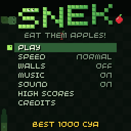
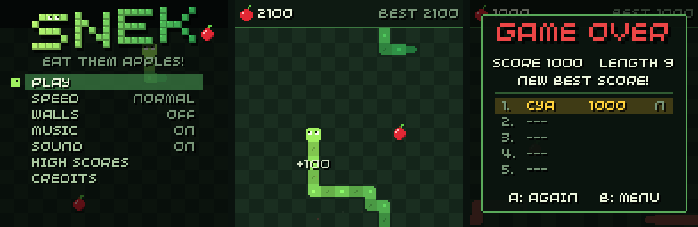

# snek

[](https://github.com/chili-chip/chili-snake/actions/workflows/build.yml)

*Eat them apples!* A polished snake game for the ChiliChip **VGC Zero**
(128x128), built on the [chilichip fork of the 32blit SDK](https://github.com/chili-chip/32blit-sdk).
It also runs on desktop (SDL) and in the browser (Emscripten).





Want to make your own game? Start from [game-template](https://github.com/chili-chip/game-template).

- Title screen with an animated logo and an attract-mode snake playing in the background
- Options: speed (slow / normal / fast), walls (wrap around or solid), music and sound on/off; saved between sessions
- Top-5 high score table with three-letter names, saved with the 32blit save API (the old v0.0.1 high score is imported)
- Golden apples every fifth apple: worth 5x, but they vanish after a few seconds
- The snake speeds up as it grows, and the music speeds up with it
- Pause menu, countdown, death animation with screen shake, particles and score popups
- Original chiptune soundtrack (title theme, in-game loop, game-over and high-score jingles) and sound effects, synthesised live on the 32blit audio channels

## Controls

| Button | Menu | In game |
| --- | --- | --- |
| D-pad | Move / change option | Steer (two turns are buffered) |
| A | Select | |
| B | Back | |
| MENU or Y | | Pause |

On desktop: arrow keys or WASD, **Z** = A, **X** = B, **V** = Y, **Esc** = MENU.

## Scoring

Each apple is worth 50 / 100 / 150 points on slow / normal / fast, plus 50 with walls on. Golden apples are worth five apples. Fill the whole board to win.

## Code layout

| File | What |
| --- | --- |
| `src/game.cpp` | Scenes (title, play, pause, game over, name entry, scores, credits) and the 32blit `init`/`update`/`render` |
| `src/snake.cpp` | Board rules: movement, turn buffer, apples, collisions, demo autopilot |
| `src/render.cpp` | All drawing: board, snake, apples, HUD, effects, logo, text helpers |
| `src/audio.cpp` | Step sequencer, soundtrack data and sound effects |
| `src/save.cpp` | Settings and high score persistence |
| `tools/make_art.py` | Regenerates the launcher splash and icon (`assets/`) |

## Building

Clone this repo next to `32blit-sdk` (and `pico-sdk` / `pico-extras` for the VGC build).

Desktop:
```
mkdir build && cd build
cmake -D32BLIT_DIR=../../32blit-sdk ..
make
./game.elf
```

VGC Zero:
```
mkdir build.vgc && cd build.vgc
cmake .. \
  -D32BLIT_DIR=../../32blit-sdk \
  -DPICO_SDK_PATH=../../pico-sdk \
  -DPICO_BOARD=chilichip_vgc \
  -DPICO_PLATFORM=rp2350-arm-s \
  -DCMAKE_TOOLCHAIN_FILE=../../32blit-sdk/pico2.toolchain
make
```
See the [VGC build guide](https://github.com/chili-chip/32blit-sdk/blob/master/docs/vgc.md) for details,
and [flash over SWD](#flashing-to-pico-via-swd) below.

To build an installable `.blit` for the VGC Zero loader instead of a standalone `.uf2`, add
`-DBLIT_EXECUTABLE_PICO_BLIT=1` to the vgc cmake command (or use the `vgc-blit` preset), then install it over USB with
`32blit install game.blit`. The console needs the loader flashed first; see the
[loader instructions](https://github.com/chili-chip/32blit-sdk/blob/master/docs/vgc.md#loader-and-blit-games-os-preview).

Platform and editor specific instructions are in the [32blit SDK fork](https://github.com/chili-chip/32blit-sdk/blob/master/docs/vgc.md)
(for Visual Studio, follow the "Option 2" instructions, as this repo does not contain a solution file).

## VS Code Setup (Optional but Recommended)

For the best development experience with VS Code, install these extensions:
- **CMake Tools** - For building and configuring the project with CMake
- **Cortex-Debug** - For debugging on the Pico 2 with OpenOCD

These extensions enable integrated building, flashing, and debugging directly from VS Code.

## Flashing to Pico via SWD

Make sure you have:
- raspberrypi's [openocd fork ](https://github.com/raspberrypi/openocd) installed (rp2350 support not yet in openocd) 
- Pico Debugger or Picoprobe connected via SWD pins (SWDIO, SWCLK, GND)
- The game has been built successfully (produces `game.elf`)


To flash the built executable to your Raspberry Pi Pico using the Pico Debugger over SWD:

```bash
cd build
openocd -f interface/cmsis-dap.cfg -f target/rp2350.cfg -c "adapter speed 5000; program "game.elf" verify reset exit"
```

## Licence

MIT, see [LICENSE](LICENSE). The music, sound effects and art were made for this game and are covered by the same licence.
